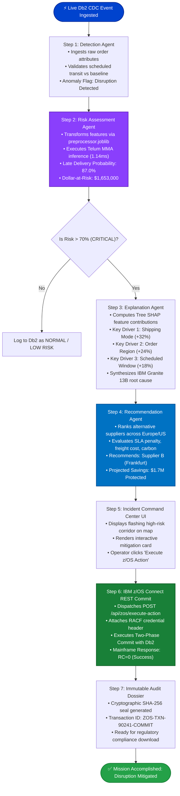

# 🛡️ ChainSentinel: Enterprise System Architecture & Workflow Pipeline
> **IBM Z Datathon 2026 | Team PingXero**  
> *AI-Powered Closed-Loop Supply-Chain Resilience on IBM LinuxONE (s390x) & IBM Db2 for z/OS*

---

## 1. High-Level System Architecture

```mermaid
graph TB
    subgraph DataTier["1. Mainframe Data & CDC Ingestion"]
        DB2["IBM Db2 for z/OS<br/>(Transaction Ledger)"]
        CDC["IBM Db2 Data Gate CDC<br/>(Change Data Capture)"]
        Cleaner["Zero-Leakage Ingestion Pipeline<br/>(Drops Post-Delivery Features)"]
        DB2 --> CDC
        CDC --> Cleaner
    end

    subgraph AccelTier["2. On-Chip ML Acceleration (IBM Telum)"]
        Cleaner --> Preprocessor["OneHotEncoder & StandardScaler<br/>(preprocessor.joblib)"]
        Preprocessor --> Telum["IBM Telum Processor (s390x)<br/>Matrix Multiply Assist (MMA)"]
        Telum --> Clf["Disruption Risk Classifier<br/>(RandomForest / XGBoost)"]
        Telum --> Reg["Duration Regressor<br/>(Multi-Output Fastest / Normal Days)"]
        Clf --> Metrics["Risk Probability & Dollar-at-Risk ($)"]
        Reg --> Metrics
    end

    subgraph AgentTier["3. LangGraph Multi-Agent Orchestration (IBM Granite 13B)"]
        Metrics --> DetectionAgent["Detection Agent<br/>(Flags Logistics Anomalies)"]
        DetectionAgent --> RiskAgent["Risk Assessment Agent<br/>(Evaluates Exposure & SLA Impact)"]
        RiskAgent --> ExplanationAgent["Explanation Agent<br/>(Tree SHAP + Granite Rationale)"]
        ExplanationAgent --> RecAgent["Recommendation Agent<br/>(Multi-Criteria Optimal Supplier Triage)"]
    end

    subgraph ExecutionTier["4. Closed-Loop Execution & Governance (IBM Z)"]
        RecAgent --> HumanLoop{"Operator Review<br/>or Auto-Trigger?"}
        HumanLoop -->|Approved| ZOS["IBM z/OS Connect EE<br/>(REST API Gateway)"]
        ZOS --> RACF["IBM RACF Security Suite<br/>(Role Authorization DSN.ADMIN)"]
        RACF --> TwoPC["Two-Phase Commit (2PC)<br/>(ACID Database Write RC=0)"]
        TwoPC --> DB2
        TwoPC --> Audit["Compliance Audit Dossier<br/>(Cryptographic SHA-256 Seal)"]
    end

    subgraph UITier["5. Command Center & Observability"]
        Cleaner -.-> LiveMap["Global Route Command Center<br/>(Leaflet Geospatial Map)"]
        ExplanationAgent -.-> TriageUI["Incident Triage Drawer<br/>(SHAP Attribution & Granite Summary)"]
        Audit -.-> AuditVault["Executive Governance Vault<br/>(JSON Dossier & Print Certificate)"]
        UITier -.-> Copilot["IBM Granite Copilot<br/>(Typo-Tolerant Natural Language Chat)"]
    end
```

---

## 2. Multi-Agent StateGraph Execution Flowchart

This flowchart illustrates the step-by-step cycle when a high-value shipment (e.g., Order #4471 with $1.9M Value at Risk) encounters a transit delay:



---

## 3. Component Details & Interface Specification

| Stage | Component | Technology / File | Primary Function | Output / SLA |
| :--- | :--- | :--- | :--- | :--- |
| **Ingestion** | Db2 Data Gate CDC | `src/stream_simulator.py` | Stream real-time purchase & shipment records | Zero-leakage sanitized schema |
| **Preprocessing** | Feature Pipeline | `src/data_pipeline.py` | One-hot encodes categories & scales numericals | Transformed dense tensor |
| **Inference** | Telum MMA Models | `src/predict_risk.py` | Predicts late delivery probability & days | **1.14 ms** inference latency |
| **Detection** | Anomaly Agent | `src/agents/detection_agent.py` | Flags orders exceeding standard deviation | Status flag (`DISRUPTED`) |
| **Attribution** | Tree SHAP + Granite | `src/agents/explanation_agent.py` | Computes feature attribution & LLM explanation | Explainable risk driver bars |
| **Mitigation** | Ranking Agent | `src/agents/recommendation_agent.py` | Multi-criteria optimization ranking | Supplier candidate recommendation |
| **Execution** | z/OS Connect API | `src/server.py` (`/api/zos/execute-action`) | 2-Phase Commit transaction to Db2 for z/OS | `RC=0` (ACID committed) |
| **Audit** | Compliance Vault | `src/server.py` (`/api/compliance/audit-dossier`) | Generates tamper-proof compliance report | SHA-256 sealed audit JSON/PDF |
